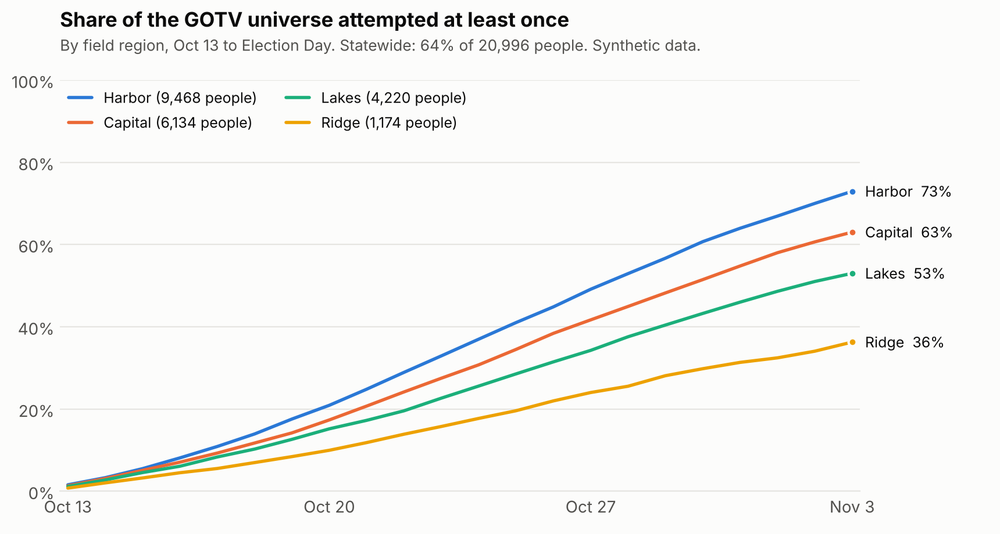
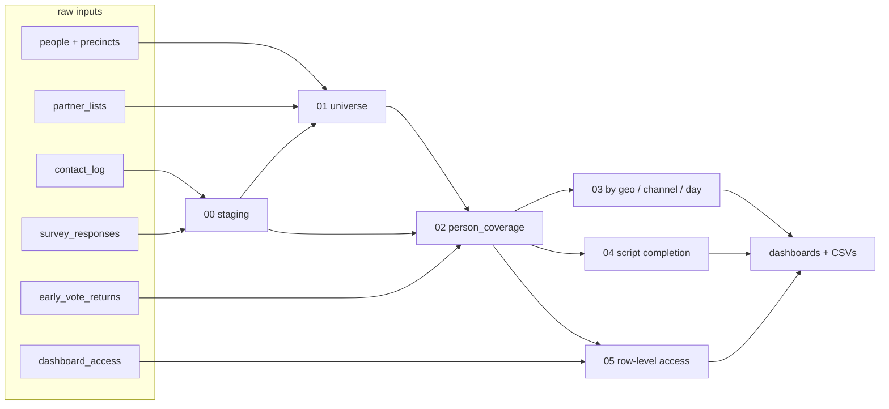

# GOTV Coverage Pipeline

A SQL pipeline that answers the questions a campaign's data team gets every day of get-out-the-vote: **how much of our target universe have we tried to reach, how much have we actually talked to, who has already voted, and who is still untouched?** It produces a person-level coverage table, rollups by geography, channel, and day, a script-completion report, and row-level security so each organizer sees only their own turf.

It runs on [DuckDB](https://duckdb.org) against a synthetic voter file for **Westmark**, a fictional state, so you can clone it and run it in seconds with no cloud account. See [Porting to BigQuery](#porting-to-bigquery) for the production equivalent.



## Quick start

From the repo root (Python 3.11+):

```bash
pip install -r requirements.txt
python synthetic/generate.py              # synthetic voter file and field program -> data/raw/
python gotv_coverage/run_pipeline.py      # build, run 24 checks, export summaries
python gotv_coverage/make_chart.py        # optional: redraw the chart above
```

The build takes under a second. It writes `data/westmark.duckdb` and CSVs in [`output/`](output/). To see the dashboards as they stood partway through GOTV, pass a snapshot date:

```bash
python gotv_coverage/run_pipeline.py --as-of 2026-10-27
```

## How it fits together



| Step | File | Main outputs | What it does |
|---|---|---|---|
| 0 | [`00_staging.sql`](sql/00_staging.sql) | `stg_contacts`, `stg_responses`, `pre_gotv_support` | Converts UTC timestamps to local days, attaches outcome rules (attempt? reach? exclusion?) and survey labels, and applies the text-attempt rule once |
| 1 | [`01_universe.sql`](sql/01_universe.sql) | `universe`, `universe_exclusions`, `universe_funnel` | Pulls people in from three sources, collapses to one row each, removes people for documented reasons, and reports the funnel |
| 2 | [`02_coverage.sql`](sql/02_coverage.sql) | `person_channel`, `person_coverage` | Rolls contact attempts up per person and channel, pivots wide, and adds ballot-return and self-reported voting status |
| 3 | [`03_summaries.sql`](sql/03_summaries.sql) | `coverage_by_geo`, `channel_summary`, `daily_progress` | Rollups for every reporting level in one pass, channel performance, and cumulative daily progress |
| 4 | [`04_script.sql`](sql/04_script.sql) | `script_answers`, `script_person`, `script_summary` | For people reached, how much of the GOTV script was actually asked |
| 5 | [`05_access.sql`](sql/05_access.sql) | `access_grants`, `coverage_for()`, `person_coverage_by_viewer` | Row-level security by region, congressional district, or house district |
| ✓ | [`checks.sql`](sql/checks.sql) | — | 24 data checks, run after every build |

Settings live in [`config.toml`](config.toml): the GOTV start date, the snapshot date, universe thresholds, the text rule, and the script questions. Routine changes never touch the SQL.

## Following two people through the pipeline

Both people below start as modeled supporters and both refused a phone call. The pipeline treats them differently, and that difference is the most important design decision here.

**Contact log (after staging).** GOTV starts Oct 13.

| person_id | contact_day | channel | outcome | counts_as_attempt | is_exclusion |
|---|---|---|---|---|---|
| 101442 | 2026-09-14 | text | sent | false | false |
| 101442 | 2026-10-06 | phone | refused | true | **true** |
| 101042 | 2026-10-15 | phone | refused | true | **true** |
| 101042 | 2026-10-17 | text | sent | false | false |

**`universe_exclusions`.** Only refusals logged *before* GOTV started remove anyone:

| person_id | reason | evidence_day |
|---|---|---|
| 101442 | contact:phone/refused | 2026-10-06 |

101042's refusal came on Oct 15, during GOTV, so they stay in the universe.

**`person_channel`.** One row per person per channel worked during GOTV. 101442 isn't in the universe, so they appear in no later table.

| person_id | channel | attempts | attempted | reached |
|---|---|---|---|---|
| 101042 | phone | 1 | true | false |
| 101042 | text | 0 | false | false |

The refusal counts as a phone attempt. The unanswered text does not count, under the default rule that a text is only an attempt if the person replies.

**`person_coverage`.** Pivoted wide, with voting status added:

| person_id | region | phone_attempted | text_attempted | any_attempted | any_reached | vote_status |
|---|---|---|---|---|---|---|
| 101042 | Capital | true | false | true | false | returned |

## Design decisions

**The universe is frozen at GOTV start.** Every rate divides by the universe. If a mid-GOTV refusal removed someone, the denominator would shrink and coverage would rise without anyone doing more work. Instead, refusals before the start date exclude people, and refusals during GOTV count as worked attempts. A check (`contact_exclusions_predate_gotv`) enforces the rule. Breaking it on purpose makes 3,328 rows fail and stops the build. Running with `--as-of 2026-10-27` shows the payoff: the universe is still exactly 20,996 people, and only the rates have moved.

**What counts as an attempt is configurable, because it's a judgment call.** Texts are nearly free to send in bulk, so counting every delivered text makes coverage look much better than the work behind it. The default counts a text only when the person replies. The alternative is one line in the config:

| `text_attempt_rule` | Statewide attempted | Contact rate |
|---|---|---|
| `responded` (default) | 64.0% | 42.8% |
| `sent` | 70.6% | 38.9% |

**"Any channel" can't disagree with the channels.** `any_attempted` and `any_reached` are built from the same rows as the per-channel flags. The log also holds volunteer-event check-ins, which aren't voter contact. A single allowlist in staging keeps them out of every number, and a check fails if a channel ever shows up without its own columns.

**Rules live in data, not in `CASE` statements.** Whether an outcome is an attempt, a reach, or grounds for exclusion comes from [`outcome_codes.csv`](../synthetic/seeds/outcome_codes.csv). Adding a new outcome is a one-row change, and a check fails if the log contains an outcome the table doesn't know.

**Every exclusion leaves a reason.** `universe_exclusions` keeps one row per person per reason. `universe_funnel` credits each removal to one reason in a fixed order, so its columns always add up:

| entry_source | candidates | removed_registration | removed_opposed | removed_contact_result | in_universe |
|---|---|---|---|---|---|
| model | 18,264 | 332 | 9 | 200 | 17,723 |
| partner:educators | 1,467 | 27 | 1 | 14 | 1,425 |
| partner:rivers | 1,140 | 26 | 7 | 13 | 1,094 |
| self_id | 799 | 11 | 0 | 34 | 754 |
| **total** | **21,670** | **396** | **17** | **261** | **20,996** |

**The state's ballot file comes first, and self-reports fill the gap.** `vote_status` is `returned` when the state's file shows a ballot, `self_reported` when the person told a volunteer they voted, and `not_yet` otherwise. `still_to_vote_untouched` (hasn't voted, never attempted) is the last-weekend work list.

**Unanswered questions are rows, not gaps.** Script completion builds every (person × question) slot first, then LEFT JOINs the latest answer. Starting from the answers would hide skipped questions. Only ordinal questions carry a `score_value`, so averaging it can't mix in a yes/no question. Statewide, 48% of conversations covered the whole script.

**Every geography comes from one GROUPING SETS pass.** Statewide, region, congressional, senate, and house rollups are computed together, so they come from one snapshot and always reconcile. Checks confirm the regions sum to the state.

**Row-level security doesn't double-count.** A viewer can hold overlapping scopes, like a region plus a district inside it. A plain join gives them duplicate rows. In the sample data, `two.hats@example.org` would get 7,045 rows for 5,394 people, which inflates every count on their dashboard by 31%. The `access_grants` view deduplicates once, and both delivery options read from it: a `coverage_for(email)` table macro for tools that pass a parameter, and a one-row-per-viewer view for BI tools that filter on the logged-in email.

## Checks

`run_pipeline.py` runs every block in [`checks.sql`](sql/checks.sql) after the build. Each check returns the rows that break a rule, and the run exits non-zero if any check returns rows. They cover:

- **Input coding:** every contact outcome and survey answer is known
- **Universe integrity:** one row per person, no excluded person kept, the frozen rule holds, and the funnel reconciles
- **Coverage logic:** reached implies attempted, "any" agrees with the channels, and attempts fall inside the window
- **Rollups:** the state row matches the person table, regions sum to the state, the channel summary matches, and daily progress never decreases and ends at the totals
- **Script:** every person has every slot, and only scored questions carry scores
- **Access:** a region lead sees only their region, the data team sees everyone, unknown emails see nothing, overlapping scopes don't duplicate, and email matching ignores case

## Porting to BigQuery

The SQL uses portable patterns. The DuckDB-specific pieces have direct BigQuery equivalents:

| Here (DuckDB) | BigQuery |
|---|---|
| `SET VARIABLE x = ...` / `getvariable('x')` | `DECLARE x ...` in a multi-statement scheduled query |
| `count(*) FILTER (WHERE ...)` | `COUNTIF(...)` |
| `bool_or(...)` | `LOGICAL_OR(...)` |
| `arg_min(x, {...struct})` | `ARRAY_AGG(x ORDER BY ... LIMIT 1)[OFFSET(0)]` |
| `UNPIVOT ... ON (a, b) AS door, ...` | `UNPIVOT ((attempted, reached) FOR channel IN (...))` |
| Reusing a column alias later in the same `SELECT` | Repeat the expression, or wrap the query in a CTE |
| `timezone('America/Chicago', ts)` | `DATE(ts, 'America/Chicago')` |
| `coverage_for(email)` table macro | Table function, or an authorized view filtered on `SESSION_USER()` |
| `checks.sql` run by Python | Dataform/dbt assertions, or a final step that calls `ERROR()` |

## Data

Everything comes from [`synthetic/generate.py`](../synthetic/generate.py) with a fixed seed: 60,000 people in 10 counties, 4 field regions, and 4 congressional, 12 senate, and 36 house districts. It also generates two coalition partner lists, about 55,000 contact attempts across a persuasion phase and GOTV, about 20,000 survey answers, and the state's returned-ballot file. Support and turnout scores are random draws, not model output. The field program works some regions harder than others, so the dashboards have something to show.
